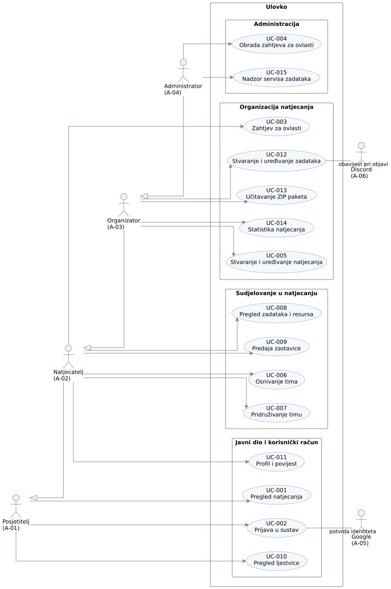

# 3. Obrasci uporabe

Obrasci uporabe opisuju ciljeve koje korisnici ostvaruju u sustavu Ulovko i njegove odgovore na njihove radnje. Akteri su preuzeti iz [analize zahtjeva](./2-Analiza-zahtjeva.md#23-dionici-i-akteri), a veze s funkcijskim zahtjevima prikazane su u [matrici sljedivosti](./2-Analiza-zahtjeva.md#26-sljedivost-zahtjeva).

## 3.1 Dijagram obrazaca uporabe

**Slika 3.1.** Dijagram obrazaca uporabe sustava Ulovko.

**PlantUML izvor:** [3-1-ulovko-system-UC.puml](./puml/3-1-ulovko-system-UC.puml)

Dijagram prikazuje četiri korisničke uloge: posjetitelja (A-01), natjecatelja (A-02), organizatora (A-03) i administratora (A-04). Uloge s višim ovlastima zadržavaju mogućnosti nižih uloga. Vanjski pružatelj identiteta (A-05) sudjeluje u prijavi, a Discord (A-06) prima obavijesti povezane s objavom zadataka. Oba su vanjska sustava sekundarni akteri.

## 3.2 Specifikacije obrazaca uporabe

### UC-001: Pregled natjecanja

| Element specifikacije | Opis |
| :--- | :--- |
| **Primarni akter** | Posjetitelj (A-01) |
| **Povezani zahtjevi** | F-003 |
| **Preduvjeti** | Nema. |
| **Glavni uspješni tok** | 1. Posjetitelj otvara popis natjecanja. 2. Sustav prikazuje javna natjecanja, njihovo vrijeme održavanja i status (nadolazeće, u tijeku ili završeno). 3. Posjetitelj odabire natjecanje. 4. Sustav prikazuje naziv, opis, raspored i javne informacije o odabranom natjecanju. |
| **Alternativni tokovi / iznimke** | **2a — Nema natjecanja:** Sustav prikazuje prazan popis s odgovarajućom porukom. **4a — Natjecanje ne postoji ili nije javno dostupno:** Sustav ne prikazuje njegove podatke i obavještava posjetitelja. **2b — Dohvat nije uspio:** Sustav prikazuje pogrešku i omogućuje ponovni pokušaj. |
| **Posljedice (ishod)** | Posjetitelj dobiva pregled dostupnih natjecanja bez prijave u sustav. |

### UC-002: Prijava u sustav

| Element specifikacije | Opis |
| :--- | :--- |
| **Primarni akter** | Posjetitelj (A-01); sekundarni akter: vanjski pružatelj identiteta (A-05) |
| **Povezani zahtjevi** | F-001 |
| **Preduvjeti** | Korisnik nije prijavljen i može pristupiti vanjskom pružatelju identiteta. |
| **Glavni uspješni tok** | 1. Korisnik odabire prijavu putem Google računa. 2. Sustav preusmjerava korisnika vanjskom pružatelju identiteta. 3. Korisnik potvrđuje identitet kod pružatelja. 4. Sustav prihvaća potvrđeni identitet, pronalazi ili otvara korisnički račun i uspostavlja sesiju. 5. Korisnik se vraća u aplikaciju s pristupom funkcijama svoje uloge. |
| **Alternativni tokovi / iznimke** | **3a — Korisnik odustaje ili prijava ne uspije:** Sesija se ne otvara i korisnik može ponoviti prijavu. **4a — Identitet nije moguće provjeriti:** Sustav odbija prijavu i ne dopušta zaštićene radnje. **5a — Odjava:** Na zahtjev prijavljenog korisnika sustav prekida sesiju i vraća ga na javni dio aplikacije. |
| **Posljedice (ishod)** | Korisnik ima valjanu sesiju i pripadajuće ovlasti, ili ostaje neprijavljen. |

### UC-003: Podnošenje zahtjeva za organizatorske ovlasti

| Element specifikacije | Opis |
| :--- | :--- |
| **Primarni akter** | Natjecatelj (A-02) |
| **Povezani zahtjevi** | F-002 |
| **Preduvjeti** | Korisnik je prijavljen i nema organizatorske ovlasti. |
| **Glavni uspješni tok** | 1. Natjecatelj otvara mogućnost zahtjeva za organizatorske ovlasti. 2. Sustav prikazuje podatke potrebne za podnošenje zahtjeva. 3. Natjecatelj ispunjava zahtjev i potvrđuje slanje. 4. Sustav pohranjuje zahtjev za administratorski pregled i prikazuje njegov status. |
| **Alternativni tokovi / iznimke** | **3a — Nedostaju obvezni podaci:** Sustav traži dopunu bez pohrane zahtjeva. **4a — Zahtjev već čeka obradu:** Sustav prikazuje postojeći status umjesto stvaranja duplikata. **4b — Pohrana nije uspjela:** Sustav prijavljuje neuspjeh podnošenja. |
| **Posljedice (ishod)** | Zahtjev je evidentiran; korisničke se ovlasti ne mijenjaju prije administratorske odluke. |

### UC-004: Obrada zahtjeva za organizatorske ovlasti

| Element specifikacije | Opis |
| :--- | :--- |
| **Primarni akter** | Administrator (A-04) |
| **Povezani zahtjevi** | F-002 |
| **Preduvjeti** | Administrator je prijavljen; postoji zahtjev za obradu. |
| **Glavni uspješni tok** | 1. Administrator otvara popis zahtjeva. 2. Sustav prikazuje podnositelja, sadržaj i status odabranog zahtjeva. 3. Administrator odobrava ili odbija zahtjev. 4. Sustav bilježi odluku i mijenja status zahtjeva. 5. Ako je zahtjev odobren, podnositelj dobiva organizatorske ovlasti. |
| **Alternativni tokovi / iznimke** | **3a — Administrator odustaje:** Zahtjev ostaje nepromijenjen. **4a — Zahtjev je već obrađen:** Sustav odbija ponovnu obradu i prikazuje trenutačno stanje. **4b — Nedostatne ovlasti:** Sustav odbija radnju i ne mijenja podatke. |
| **Posljedice (ishod)** | Zahtjev ima zabilježenu odluku, a korisničke se ovlasti mijenjaju samo nakon odobrenja. |

### UC-005: Stvaranje i uređivanje natjecanja

| Element specifikacije | Opis |
| :--- | :--- |
| **Primarni akter** | Organizator (A-03) |
| **Povezani zahtjevi** | F-004 |
| **Preduvjeti** | Organizator je prijavljen i ima odgovarajuće ovlasti. |
| **Glavni uspješni tok** | 1. Organizator otvara organizacijski dio aplikacije te odabire stvaranje natjecanja ili vlastito postojeće natjecanje. 2. Sustav prikazuje obrazac s nazivom, opisom, vremenom početka i završetka te postavkama natjecanja. 3. Organizator unosi ili mijenja podatke i potvrđuje spremanje. 4. Sustav provjerava valjanost rasporeda, podataka i organizatorovih ovlasti. 5. Sustav pohranjuje natjecanje i prikazuje njegove detalje u organizacijskom sučelju. |
| **Alternativni tokovi / iznimke** | **4a — Nevaljan raspored ili obvezni podaci:** Sustav prikazuje pogreške i zadržava unos radi ispravka. **4b — Uređivanje tuđeg natjecanja:** Sustav odbija promjenu. **5a — Pohrana nije uspjela:** Sustav ne prikazuje potvrdu o uspjehu i omogućuje ponovni pokušaj. |
| **Posljedice (ishod)** | Natjecanje je stvoreno ili su njegove dopuštene postavke ažurirane. Po isteku natjecanja sustav pokreće postupak uklanjanja pripadajućih servisa. |

### UC-006: Osnivanje tima

| Element specifikacije | Opis |
| :--- | :--- |
| **Primarni akter** | Natjecatelj (A-02) |
| **Povezani zahtjevi** | F-005, F-006 |
| **Preduvjeti** | Natjecatelj je prijavljen i nije član drugog tima u odabranom natjecanju. |
| **Glavni uspješni tok** | 1. Natjecatelj otvara stranicu natjecanja i odabire osnivanje tima. 2. Sustav prikazuje obrazac za naziv tima. 3. Natjecatelj unosi naziv i potvrđuje osnivanje. 4. Sustav stvara tim za odabrano natjecanje, osnivača postavlja kao člana odnosno kapetana i omogućuje dijeljenje pristupnog koda. 5. Sustav prikazuje podatke novog tima. |
| **Alternativni tokovi / iznimke** | **3a — Nevaljan naziv ili nedopušteni podaci:** Sustav traži ispravak. **4a — Korisnik već pripada timu istog natjecanja:** Sustav odbija stvaranje drugog članstva. **4b — Pohrana nije uspjela:** Tim nije osnovan. |
| **Posljedice (ishod)** | Tim i članstvo osnivača povezani su s odabranim natjecanjem; članstva u drugim natjecanjima ostaju nepromijenjena. |

### UC-007: Pridruživanje timu

| Element specifikacije | Opis |
| :--- | :--- |
| **Primarni akter** | Natjecatelj (A-02) |
| **Povezani zahtjevi** | F-005, F-006 |
| **Preduvjeti** | Natjecatelj je prijavljen i ne pripada timu u odabranom natjecanju; raspolaže pozivnicom ili kodom tima. |
| **Glavni uspješni tok** | 1. Natjecatelj na stranici natjecanja odabire pridruživanje timu. 2. Unosi pristupni kod ili otvara pozivnicu. 3. Sustav provjerava valjanost pozivnice i pripadnost tima odabranom natjecanju. 4. Sustav provjerava da natjecatelj još nema članstvo u tom natjecanju. 5. Sustav evidentira članstvo i prikazuje podatke tima. |
| **Alternativni tokovi / iznimke** | **3a — Neispravan kod ili tim ne pripada natjecanju:** Sustav odbija pridruživanje. **4a — Postojeće članstvo:** Sustav ne stvara novo članstvo te upućuje korisnika na njegov tim. **5a — Upis članstva nije uspio:** Korisnik ostaje izvan tima. |
| **Posljedice (ishod)** | Natjecatelj postaje član jednog tima u odabranom natjecanju, bez utjecaja na ostala natjecanja. |

### UC-008: Pregled zadataka i pristup njihovim resursima

| Element specifikacije | Opis |
| :--- | :--- |
| **Primarni akter** | Natjecatelj (A-02) |
| **Povezani zahtjevi** | F-009, F-010, F-019, F-020 |
| **Preduvjeti** | Natjecatelj ima pravo pristupa natjecanju; odabrani zadatak objavljen je prema rasporedu. |
| **Glavni uspješni tok** | 1. Natjecatelj otvara natjecanje i popis dostupnih zadataka. 2. Sustav prikazuje objavljene zadatke s naslovom, kategorijom i bodovima. 3. Natjecatelj odabire zadatak. 4. Sustav prikazuje opis, omogućuje preuzimanje javnih priloga iz `public/` i, ako zadatak koristi servise, prikazuje dodijeljene HTTP(S) ili TCP adrese. 5. Natjecatelj pristupa prilozima odnosno servisu radi rješavanja zadatka. |
| **Alternativni tokovi / iznimke** | **2a — Zadatak nije objavljen:** Sustav ga ne prikazuje natjecatelju niti otkriva njegove privatne datoteke. **4a — Zadatak nema javnih priloga ili servisa:** Sustav prikazuje samo raspoložive resurse. **4b — Servis nije dostupan:** Sustav prikazuje stanje ili pogrešku, a statički zadaci i njihovi prilozi ostaju dostupni. **4c — Nedopušten pristup prilozima:** Sustav odbija preuzimanje. |
| **Posljedice (ishod)** | Natjecatelj dobiva pristup dopuštenom sadržaju i krajnjim točkama objavljenog zadatka; izvori iz `deploy/` i zastavica ostaju skriveni. |

### UC-009: Predaja zastavice

| Element specifikacije | Opis |
| :--- | :--- |
| **Primarni akter** | Natjecatelj (A-02), u ime tima |
| **Povezani zahtjevi** | F-011, F-012, F-013 |
| **Preduvjeti** | Natjecatelj je prijavljen, pripada timu odabranog natjecanja i zadatak je dostupan za rješavanje. |
| **Glavni uspješni tok** | 1. Natjecatelj na stranici zadatka unosi pronađenu zastavicu. 2. Sustav provjerava ovlasti, vrijeme natjecanja i dostupnost zadatka. 3. Sustav uspoređuje predanu zastavicu s očekivanom vrijednošću i provjerava postoji li već rješenje toga tima. 4. Za prvu točnu predaju sustav bilježi rješenje i određuje bodove prema statičkom ili dinamičkom načinu bodovanja. 5. Sustav prikazuje rezultat predaje; odgovarajući bodovi odražavaju se na ljestvici. |
| **Alternativni tokovi / iznimke** | **2a — Nema valjanog članstva ili zadatak nije dostupan:** Sustav odbija predaju. **3a — Netočna zastavica:** Sustav prikazuje neuspješnu provjeru, bez evidentiranja rješenja. **3b — Tim je već riješio zadatak:** Sustav prijavljuje ponovljenu predaju i ne dodjeljuje dodatne bodove. **4a — Istodobne točne predaje:** Sustav evidentira najviše jedno rješenje po timu i zadatku. |
| **Posljedice (ishod)** | Prva točna predaja evidentira se kao rješenje tima; bodovanje ostaje dosljedno i ne duplicira se. |

### UC-010: Pregled ljestvice rezultata

| Element specifikacije | Opis |
| :--- | :--- |
| **Primarni akter** | Posjetitelj (A-01) ili natjecatelj (A-02) |
| **Povezani zahtjevi** | F-014 |
| **Preduvjeti** | Natjecanje postoji i njegova je ljestvica javno dostupna. |
| **Glavni uspješni tok** | 1. Korisnik otvara javnu stranicu natjecanja i odabire ljestvicu. 2. Sustav dohvaća evidentirana rješenja i važeće vrijednosti zadataka. 3. Sustav prikazuje timove poredane po ukupnim bodovima. 4. Korisnik pregledava poredak i rezultate timova. |
| **Alternativni tokovi / iznimke** | **3a — Nema rješenja:** Sustav prikazuje praznu ljestvicu ili timove bez osvojenih bodova. **2a — Dohvat nije uspio:** Sustav prikazuje pogrešku i omogućuje ponovni pokušaj. |
| **Posljedice (ishod)** | Korisnik vidi poredak timova temeljen na evidentiranim rješenjima i odabranom modelu bodovanja. |

### UC-011: Pregled profila i povijesti sudjelovanja

| Element specifikacije | Opis |
| :--- | :--- |
| **Primarni akter** | Natjecatelj (A-02) |
| **Povezani zahtjevi** | F-015 |
| **Preduvjeti** | Korisnik je prijavljen. |
| **Glavni uspješni tok** | 1. Korisnik otvara svoj profil. 2. Sustav prikazuje podatke računa i popis natjecanja u kojima korisnik sudjeluje ili je sudjelovao. 3. Korisnik odabire natjecanje iz svoje povijesti. 4. Sustav prikazuje pripadajući tim, evidentirana rješenja i osvojene bodove. |
| **Alternativni tokovi / iznimke** | **2a — Korisnik još nije sudjelovao:** Sustav prikazuje praznu povijest. **4a — Tražen je pristup tuđim privatnim podacima:** Sustav odbija zahtjev. **2b — Dohvat nije uspio:** Sustav prikazuje pogrešku. |
| **Posljedice (ishod)** | Korisnik dobiva uvid u vlastito sudjelovanje bez otkrivanja tuđih privatnih podataka. |

### UC-012: Stvaranje i uređivanje zadataka

| Element specifikacije | Opis |
| :--- | :--- |
| **Primarni akter** | Organizator (A-03); sekundarni akter: Discord (A-06) pri slanju obavijesti |
| **Povezani zahtjevi** | F-007, F-010, F-012, F-013 |
| **Preduvjeti** | Organizator je prijavljen i ima ovlasti nad odabranim natjecanjem. |
| **Glavni uspješni tok** | 1. Organizator otvara zadatke vlastitog natjecanja te odabire novi ili postojeći zadatak. 2. Sustav prikazuje polja za naslov, opis, kategoriju, očekivanu zastavicu, način i parametre bodovanja te vrijeme objave. 3. Organizator unosi ili mijenja podatke i potvrđuje spremanje. 4. Sustav provjerava podatke i organizatorove ovlasti te pohranjuje zadatak. 5. Kada nastupi vrijeme objave, sustav omogućuje natjecateljima pristup zadatku, pokreće njegove potrebne servise i šalje konfiguriranu Discord obavijest. |
| **Alternativni tokovi / iznimke** | **4a — Nevaljani parametri, zastavica ili vrijeme:** Sustav prikazuje pogrešku i ne pohranjuje nevaljanu promjenu. **4b — Organizator nema ovlasti:** Sustav odbija radnju. **5a — Izgradnja ili pokretanje servisa nije uspjelo:** Sustav evidentira pogrešku; funkcionalnosti statičkih zadataka ostaju dostupne. **5b — Dostava Discord obavijesti nije uspjela:** Sustav bilježi pogrešku bez prekidanja objave ili bodovanja. |
| **Posljedice (ishod)** | Zadatak je povezan s natjecanjem i ima definirane uvjete objave i bodovanja. Očekivana zastavica nije dostupna natjecateljskom sučelju. |

### UC-013: Učitavanje ZIP paketa zadatka

| Element specifikacije | Opis |
| :--- | :--- |
| **Primarni akter** | Organizator (A-03) |
| **Povezani zahtjevi** | F-008 |
| **Preduvjeti** | Organizator je prijavljen, ima ovlasti nad natjecanjem i raspolaže ZIP paketom zadatka. |
| **Glavni uspješni tok** | 1. Organizator otvara zadatak i odabire učitavanje ili zamjenu ZIP paketa. 2. Odabire arhivu koja sadrži `config.yaml`, `public/` i `deploy/`. 3. Sustav provjerava strukturu arhive, valjanost konfiguracije i dopuštenost datoteka. 4. Sustav pohranjuje javne priloge odvojeno od datoteka potrebnih za izvođenje servisa. 5. Sustav povezuje paket sa zadatkom i potvrđuje uspješno učitavanje. |
| **Alternativni tokovi / iznimke** | **3a — Nevaljana arhiva ili konfiguracija:** Sustav odbija paket i prikazuje razlog. **3b — Nesigurne putanje ili nedopušten sadržaj:** Sustav odbija paket bez izdvajanja datoteka izvan dopuštenog prostora. **4a — Pohrana nije uspjela:** Sustav prijavljuje pogrešku i ne potvrđuje uspješno učitavanje. **5a — Zamjena paketa:** Novi valjani paket zamjenjuje pripadajuće datoteke zadatka, bez nenamjerne objave izvora servisa. |
| **Posljedice (ishod)** | Zadatak ima pohranjen valjan paket; sadržaj `public/` može biti javno dostupan prema pravilima objave, a `deploy/` služi izgradnji servisa. |

### UC-014: Pregled statistike natjecanja

| Element specifikacije | Opis |
| :--- | :--- |
| **Primarni akter** | Organizator (A-03) |
| **Povezani zahtjevi** | F-015 |
| **Preduvjeti** | Organizator je prijavljen i ima ovlasti nad odabranim natjecanjem. |
| **Glavni uspješni tok** | 1. Organizator otvara pregled vlastitog natjecanja. 2. Odabire statistiku natjecanja. 3. Sustav prikazuje broj prijavljenih timova, rješenja zadataka, ukupne rezultate i druge osnovne pokazatelje. 4. Organizator pregledava rezultate i uspješnost pojedinih zadataka. |
| **Alternativni tokovi / iznimke** | **3a — Nema sudionika ili rješenja:** Sustav prikazuje nulte vrijednosti i razumljivu poruku. **3b — Organizator nema pristup natjecanju:** Sustav odbija zahtjev. **3c — Dohvat nije uspio:** Sustav prikazuje pogrešku. |
| **Posljedice (ishod)** | Organizator dobiva sažet uvid u tijek i rezultate natjecanja, bez izmjene natjecateljskih podataka. |

### UC-015: Nadzor i upravljanje servisima zadataka

| Element specifikacije | Opis |
| :--- | :--- |
| **Primarni akter** | Administrator (A-04) |
| **Povezani zahtjevi** | F-022 |
| **Preduvjeti** | Administrator je prijavljen; postoji evidentiran servis ili pokušaj njegova pokretanja. |
| **Glavni uspješni tok** | 1. Administrator otvara pregled servisa zadataka. 2. Sustav prikazuje natjecanje, zadatak, stanje servisa, njegove krajnje točke i raspoložive informacije o pogreškama. 3. Administrator odabire servis koji zahtijeva intervenciju. 4. Administrator zatraži ponovno pokretanje. 5. Sustav provjerava ovlasti, prosljeđuje zahtjev Runneru, bilježi radnju i prikazuje novi status. |
| **Alternativni tokovi / iznimke** | **2a — Nema aktivnih servisa:** Sustav prikazuje prazan pregled. **4a — Administrator odustaje:** Nijedna radnja nije pokrenuta. **5a — Runner nije dostupan ili restart nije uspio:** Sustav evidentira neuspjeh i prikazuje pogrešku bez netočnog prikaza uspjeha. **5b — Nedostatne ovlasti:** Sustav odbija radnju. |
| **Posljedice (ishod)** | Administrator ima pregled stanja i zabilježenu intervenciju; sustav održava evidenciju promjene stanja servisa. |

## 3.3 Provjera dosljednosti obrazaca uporabe

Dijagram u odjeljku 3.1 i specifikacije u odjeljku 3.2 obuhvaćaju istih 15 obrazaca uporabe. Potpuno mapiranje zahtjeva na obrasce uporabe ili automatsko ponašanje sustava nalazi se u [odjeljku 2.6](./2-Analiza-zahtjeva.md#26-sljedivost-zahtjeva).

Zahtjevi koji nisu samostalni korisnički ciljevi obuhvaćeni su pripadajućim tijekovima i ponašanjem sustava: Discord obavijesti (F-016), izgradnja i objava servisa (F-017 i F-018), mrežna dostupnost i komunikacija servisa (F-019 – F-021), uklanjanje servisa po završetku natjecanja (F-023) te neovisnost statičkih zadataka o Runneru (F-024). Challenge Runner zato nije dodatni akter dijagrama.
