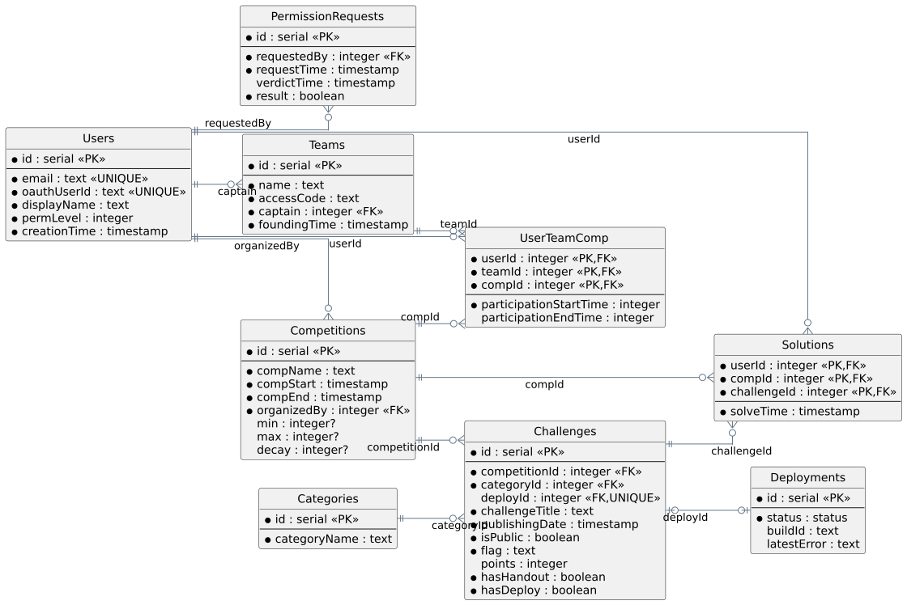
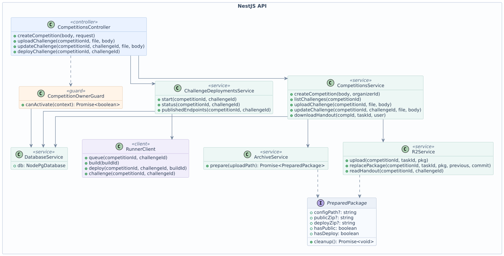
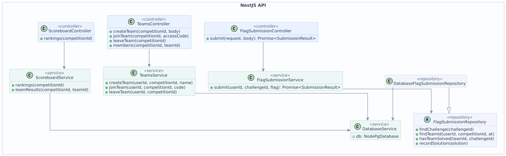
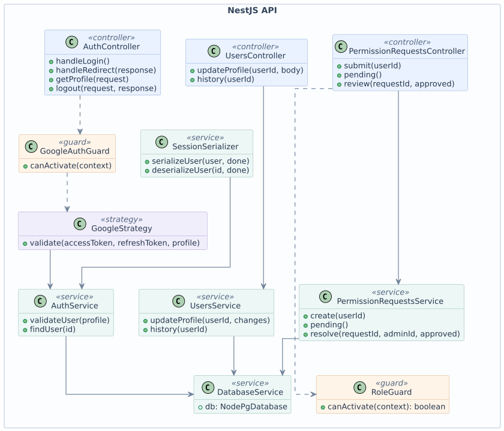

# 4. Arhitektura i oblikovanje

**Cilj:** Definirati arhitekturni stil, dekompoziciju programa na podsustave i module, organizaciju podataka te dinamičko ponašanje tijekom izvođenja. Arhitektura predstavlja temelj za implementaciju i ažurira se pri svakoj važnijoj promjeni projektnih odluka.

| Arhitekturni pogled | Ključno inženjersko pitanje | Primijenjeni model ili dijagram |
| :--- | :--- | :--- |
| **Strategija rješenja** | Koji stil i temeljne odluke određuju program? | Tablica odluka (odjeljak 4.1) |
| **Struktura podsustava** | Koji su glavni dijelovi i kako komuniciraju? | Dijagram komponenata |
| **Model podataka** | Kako su strukturirani trajni podaci programa? | Relacijski ER dijagram |
| **Struktura koda** | Kako su dodijeljene odgovornosti i ključne klase? | Reprezentativni dijagram razreda |
| **Dinamičko ponašanje** | Kako moduli surađuju pri obradi ključnih transakcija? | sekvencijski dijagram |
| **Stanja sustava** | Kako ključni domenski objekt mijenja svoja stanja? | Dijagram stanja |
| **Fizički razmještaj** | Na kojim se izvršnim čvorovima program izvodi? | Dijagram razmještaja (poglavlje 6) |

---

Za svaki UML dijagram čuvajte čitljivu sliku i PlantUML izvor, kako je opisano na stranici [Home](./Home.md). U dovršenoj stranici koristite vlastite projektne odluke i modele.

## 4.1 Ključne arhitekturne odluke

Ulovko odvaja korisnički dio natjecanja od izvođenja potencijalno nepouzdanih servisa zadataka. Sljedeće odluke određuju granice odgovornosti, način pohrane i razmjenu podataka među dijelovima sustava.

| Odluka | Razmatrana alternativa | Projektno specifično obrazloženje i kompromis |
| --- | --- | --- |
| **React aplikacija u pregledniku i jedan modularni NestJS API** | Poslužiteljski generirane stranice ili više neovisno postavljenih API usluga | Korisničko sučelje odvojeno je od poslovnih pravila, a NestJS moduli grupiraju prijavu, natjecanja, zadatke i predaje zastavica. Jedan API pojednostavljuje razvoj i autentikaciju za studentski tim, ali predstavlja zajedničku točku otkaza. |
| **Challenge Runner na zasebnom poslužitelju** | Izvođenje zadataka zajedno s web-aplikacijom i bazom podataka | Zadaci sadrže proizvoljan korisnički kod i mogu trošiti znatne resurse. Zaseban Runner smanjuje utjecaj tih servisa na prijavu, bodovanje i ostale funkcije platforme. Cijena je dodatna infrastruktura i komunikacija između poslužitelja. |
| **K3s za upravljanje kontejnerima zadataka** | Vlastiti sustav koji izravno pokreće Docker kontejnere i ručno upravlja mrežom | K3s pruža postojeće mehanizme za mrežne servise, izolaciju, ograničenja resursa i upravljanje instancama. Time se izbjegava pisanje vlastitog orkestratora, uz složeniju početnu konfiguraciju. Runner izlaže ograničeni API umjesto izravnog pristupa K3s-u iz web-aplikacije. |
| **PostgreSQL i relacijski model podataka** | Dokumentna baza ili pohrana poslovnih zapisa u datotekama | Natjecanja, članstva korisnika u timovima i rješenja imaju jasne veze te zahtijevaju dosljedne identifikatore i ograničenja. Drizzle ORM povezuje TypeScript kod i SQL shemu. Promjene strukture podataka zahtijevaju nadzirane migracije. |
| **Odvojena objektna pohrana ZIP paketa u Cloudflare R2** | Pohrana svih arhiva u PostgreSQL-u ili lokalnom datotečnom sustavu aplikacijskog poslužitelja | Relacijska baza čuva metapodatke, a R2 čuva `config.yaml`, `public.zip` i `deploy.zip`. Tako se velike datoteke ne prenose kroz relacijske tablice i Runner im može pristupati neovisno o aplikacijskom disku. Potrebno je koordinirati upis metapodataka i objekata te obraditi djelomične neuspjehe. |
| **Provjera ZIP paketa prije pohrane i razdvajanje javnog i izvršnog sadržaja** | Pohrana i izravno izvođenje učitane arhive bez prethodne provjere | Organizator dostavlja jedinstven ZIP, ali sadržaj `public/` namijenjen je natjecateljima, a `deploy/` služi za izgradnju kontejnera. Provjeravaju se struktura arhive, putanje i `config.yaml`; preuzimanje javnog priloga ide kroz API uz provjeru prava pristupa. Takav postupak povećava složenost obrade pri učitavanju, ali smanjuje mogućnost izlaganja privatnih datoteka. |
| **Google OAuth i poslužiteljska sesija umjesto vlastitih lozinki** | Lokalna registracija s pohranom i provjerom lozinki | Identitet potvrđuje vanjski pružatelj, dok aplikacija upravlja vlastitim ulogama i pristupom natjecanjima. Time se izbjegava održavanje zaporki, uz ovisnost o vanjskom pružatelju i potrebu za zaštitom sesije. |
| **OpenAPI kao ugovor između backenda i frontenda** | Ručno pisani i neovisno održavani HTTP klijenti i modeli | NestJS objavljuje OpenAPI opis, a Orval iz njega generira TypeScript pozive i upite za React. Time se smanjuje ručno usklađivanje tipova, ali se promjene DTO-a moraju ispravno dokumentirati i generirani kod osvježiti. |

## 4.2 Gradivni blokovi i UML dijagram komponenata

**Cilj:** Prikazati logičku podjelu programa na komponente, njihova sučelja i vanjske integracije. Dijagram komponenata prikazuje logičku organizaciju, dok dijagram razmještaja prikazuje fizičko izvođenje. Ovaj prikaz ažurirajte kako sustav poprima konačan oblik.

**Dijagram komponenata:** [Ugradite čitljiv UML dijagram komponenata.]  
**PlantUML izvor:** [Poveznica na odgovarajuću `.puml` datoteku.]

| Komponenta | Odgovornost | Razlog za ovu granicu |
| --- | --- | --- |
|  |  |  |

Započnite crtanjem granice oko predloženog sustava. Unutar nje prepoznajte dijelove s različitim odgovornostima; planiranu bazu podataka aplikacije smjestite unutar granice, a usluge trećih strana izvan nje. Važne veze označite podatkom ili uslugom koja njima prolazi. Logička komponenta može biti modul unutar jedne poslužiteljske aplikacije: zaseban pravokutnik ne znači zasebno postavljenu uslugu. Tijekom implementacije ažurirajte dijagram kada se promijene odgovornosti ili veze. U završnoj inačici čitatelj treba moći povezati njegove dijelove s kodom. Dijagram razmještaja odgovara na pitanje gdje se ti dijelovi stvarno izvode.

## 4.3 Model podataka i oblikovanje razreda

### 4.3.1 ER dijagram i model podataka

**Slika 4.2.** Relacijski model podataka sustava Ulovko.

**PlantUML izvor:** [4-3-1-ulovko-data-ERD.puml](./puml/4-3-1-ulovko-data-ERD.puml)

**Implementacija:** [`db/schema.ts`](../db/schema.ts) (Drizzle ORM).

Središnji su entiteti `Users`, `Competitions` i `Challenges`. Korisnik može organizirati više natjecanja, a svako natjecanje ima jednog organizatora i više zadataka. Svaki zadatak pripada jednoj kategoriji (`Categories`) i sadrži metapodatke o objavi, vrijednosti bodova i očekivanoj zastavici. Zastavica je pohranjena u bazi radi provjere rješenja, ali nije dio javnog API odgovora.

Tim (`Teams`) ima kapetana koji je korisnik sustava. Sudjelovanje korisnika u pojedinom natjecanju zapisuje se u poveznoj tablici `UserTeamComp`, s kompozitnim primarnim ključem `(userId, teamId, compId)` i vremenima početka i završetka sudjelovanja. Takav model omogućuje korisniku sudjelovanje u više natjecanja s različitim timovima. Pravilo da korisnik u jednom natjecanju pripada najviše jednom timu provjerava poslovna logika; sam navedeni kompozitni ključ ne jamči to pravilo. Evidencija uspješnih rješenja (`Solutions`) povezuje korisnika, natjecanje i zadatak te koristi kompozitni ključ `(userId, compId, challengeId)`, čime se sprječava višestruki zapis iste kombinacije.

`PermissionRequests` bilježi zahtjeve za organizatorske ovlasti. `Deployments` sadrži stanje izgradnje i izvođenja servisa zadatka (`uploaded`, `building`, `built`, `deployed`, `error`), identifikator izgradnje i posljednju pogrešku. Veza preko `Challenges.deployId` neobavezna je i jedinstvena, pa zadatak bez izvršnih servisa ne mora imati zapis postavljanja, a pojedini zapis nije dijeljen među zadacima. Raspored natjecanja dodatno je ograničen pravilom `compEnd > compStart`.

Datoteke nisu prikazane kao zasebni relacijski entiteti jer se arhive nalaze u Cloudflare R2: za svaki zadatak pohranjuju se odgovarajući `public.zip`, `deploy.zip` i `config.yaml`. Baza vodi oznake `hasHandout` i `hasDeploy`, a identitet natjecanja i zadatka određuje lokaciju objekata. Pristup tim datotekama kontrolira aplikacijski API.

### 4.3.2 UML dijagrami razreda

Dijagrami razreda prikazuju raspodjelu odgovornosti u tri povezana dijela sustava: upravljanje natjecanjima i zadacima, sudjelovanje i bodovanje te upravljanje korisnicima i ovlastima. 

#### 4.3.2.1 Upravljanje natjecanjima i zadacima

Prvi dijagram obuhvaća obradu ZIP paketa zadataka i njihovo postavljanje na Runner (UC-012, UC-013). Prikazuje provjeru paketa, trajnu pohranu te komunikaciju s izdvojenim izvršnim sustavom.

**Slika 4.3.** UML dijagram razreda za upravljanje natjecanjima i zadacima.

**PlantUML izvor:** [4-3-2-ulovko-challenges-CD.puml](./puml/4-3-2-ulovko-challenges-CD.puml)

**Povezani moduli:** [`competitions`](../backend/src/competitions/), [`challenge-packages`](../backend/src/challenge-packages/).

`CompetitionsController` prima HTTP zahtjeve i prosljeđuje ih odgovarajućim servisima. Prije organizatorskih radnji `CompetitionOwnerGuard` provjerava pripada li natjecanje prijavljenom organizatoru odnosno ima li korisnik administratorske ovlasti. `CompetitionsService` obrađuje metapodatke zadataka te koordinira `ArchiveService` i `R2Service`. `ArchiveService` provjerava ZIP i priprema `PreparedPackage`, čiji se privremeni sadržaj uklanja metodom `cleanup()`. `R2Service` pohranjuje datoteke te omogućuje njihovu zamjenu i preuzimanje javnih priloga.

`ChallengeDeploymentsService` upravlja tijekom izgradnje i postavljanja, a `RunnerClient` pruža autentificirane HTTP operacije prema izdvojenom Runneru. `DatabaseService` omogućuje pristup trajnom stanju natjecanja i objava.

#### 4.3.2.2 Sudjelovanje u natjecanju i bodovanje

Drugi dijagram obuhvaća osnivanje i pridruživanje timovima, predaju zastavica i ljestvicu rezultata (UC-006, UC-007, UC-009, UC-010). Korisnik se timu pridružuje u kontekstu pojedinog natjecanja, a pravilo najviše jednog tima po korisniku i natjecanju provjerava `TeamsService`.

**Slika 4.4.** UML dijagram razreda za timove, predaju zastavica i bodovanje.

**PlantUML izvor:** [4-3-2-ulovko-participation-CD.puml](./puml/4-3-2-ulovko-participation-CD.puml)

**Povezani moduli:** [`flag_submission`](../backend/src/flag_submission/), [`database`](../backend/src/database/).

`FlagSubmissionController` prima predanu zastavicu, a `FlagSubmissionService` provjerava dostupnost zadatka, trajanje natjecanja, pripadnost timu i prethodna rješenja. Uspješno rješenje evidentira se samo jednom po timu i zadatku. Poslovna logika koristi apstraktni `FlagSubmissionRepository`, dok `DatabaseFlagSubmissionRepository` ostvaruje njegovo sučelje nad relacijskom bazom. `ScoreboardService` iz evidentiranih rješenja i pravila bodovanja izračunava poredak timova, a `ScoreboardController` omogućuje njegov prikaz za pojedino natjecanje.

#### 4.3.2.3 Korisnici, autentikacija i ovlasti

Treći dijagram prikazuje prijavu vanjskim pružateljem identiteta, rad s korisničkim profilom i obradu zahtjeva za organizatorske ovlasti (UC-002, UC-003, UC-004, UC-011).

**Slika 4.5.** UML dijagram razreda za autentikaciju, korisničke podatke i odobravanje ovlasti.

**PlantUML izvor:** [4-3-2-ulovko-users-CD.puml](./puml/4-3-2-ulovko-users-CD.puml)

**Povezani moduli:** [`auth`](../backend/src/auth/), [`roles`](../backend/src/roles/), [`users`](../backend/src/users/).

`AuthController` izlaže prijavu, odjavu i dohvat prijavljenog korisnika. `GoogleAuthGuard` i `GoogleStrategy` povezuju zahtjev s postupkom Google OAuth prijave, a `AuthService` pronalazi ili stvara korisnički zapis. `SessionSerializer` povezuje poslužiteljsku sesiju s korisničkim identitetom. `UsersService` obrađuje podatke profila i povijest sudjelovanja, dok `PermissionRequestsService` vodi zahtjeve za organizatorske ovlasti te odluke administratora. `RoleGuard` provjerava uloge prije zaštićenih administrativnih radnji.

## 4.4 Ponašanje tijekom izvođenja

**Cilj:** Objasniti jednu važnu interakciju među dijelovima koji se izvode i životni ciklus jednog smislenog objekta. Odaberite primjere koji otkrivaju odluke ili neuspješne putove umjesto izrade dijagrama za svaku CRUD radnju.

### 4.4.1 Reprezentativni UML sekvencijski dijagram

**Cilj:** Prikazati redoslijed poruka za jedan reprezentativni scenarij i odgovore na važnu alternativu.

**Scenarij:** [Naziv interakcije; dodajte UC ID ako postoji.]  
**sekvencijski dijagram:** [Ugradite čitljiv UML sekvencijski dijagram.]  
**PlantUML izvor:** [Poveznica na odgovarajuću `.puml` datoteku.]

<strong>Odabir lokacije, provjera valjanosti i podnošenje prijave</strong>

**Primjer — CrisisMap:** Građanin podnosi prijavu kriznog događaja nakon što ručno odabere lokaciju ili zatraži položaj uređaja. Interakcija prikazuje i što se događa kada je pristup lokaciji odbijen, podaci prijave nisu valjani ili pohrana ne uspije.

**Slika 4.4. Sekvencijski dijagram podnošenja prijave kriznog događaja**

**PlantUML izvor:** [izvor](./puml/4-4-crisismap-report-submission-SD.puml)

**Analiza primjera:** Dva načina odabira lokacije te alternative provjere i pohrane imaju različite posljedice za korisnika; usporedite ih s odgovarajućim obrascem uporabe i njegovim alternativnim tijekovima. API preglednika za lokaciju mogućnost je preglednika; web-klijent, API, usluga i pohrana odgovaraju prikazu komponenata. Odaberite grane koje pomažu objasniti scenarij vašeg projekta i završni dijagram uskladite s implementiranom interakcijom.

### 4.4.2 Reprezentativni UML dijagram stanja

**Cilj:** Prikazati važna stanja jednog domenskog objekta ili eksplicitno upravljanog načina rada sustava te događaje ili uvjete koji ih mijenjaju.

**Vlasnik stanja i razlog odabira:** [Navedite objekt ili način rada sustava, kako se njegovo stanje prepoznaje i zašto su prijelazi važni.]  
**Dijagram stanja:** [Ugradite čitljiv UML dijagram stanja.]  
**PlantUML izvor:** [Poveznica na odgovarajuću `.puml` datoteku.]

<strong>Složeno stanje sustava: koordinacija događaja i dostupnost usluge</strong>

**Primjer — CrisisMap:** Ovaj primjer ne prikazuje životni ciklus jednog domenskog objekta, nego dva neovisna aspekta stanja cijelog sustava CrisisMap. Jedna regija opisuje način koordinacije kriznog događaja, a druga opaženu dostupnost usluge. Budući da se ta dva aspekta mogu mijenjati neovisno jedan o drugome, prikazani su kao ortogonalne regije istog složenog stanja sustava.

**Slika 4.5. Dijagram stanja sustava s ortogonalnim regijama**

**PlantUML izvor:** [izvor](./puml/4-5-crisismap-system-SM.puml)

**Analiza primjera:** Vlasnik stanja u ovom je primjeru sustav CrisisMap, a ne pojedinačna prijava kriznog događaja. Dvije ortogonalne regije opisuju stanja koja vrijede istodobno: način koordinacije kriznog događaja i dostupnost usluge. Promjena stanja u jednoj regiji ne mora promijeniti stanje u drugoj; primjerice, aktivni krizni događaj može postojati dok je usluga potpuno ili djelomično dostupna.

Prijelazi imaju imenovane događaje ili uvjete, a grane nakon oporavka poslužiteljskog sustava uzimaju u obzir da pružatelj kartografskih usluga može i dalje biti nedostupan. Time primjer pokazuje situaciju u kojoj ortogonalne regije imaju stvarnu semantičku svrhu, a nisu samo način vizualnog grupiranja elemenata.

Ovo je napredniji primjer dijagrama stanja. Koristite takav oblik samo ako sustav stvarno održava dva ili više međusobno neovisnih aspekata stanja koji se mogu mijenjati istodobno. Za projekt u kojem je važan životni ciklus jednog objekta, primjerice prijave, rezervacije ili narudžbe, jednostavniji dijagram stanja tog objekta obično je prikladniji. Složenost dijagrama nije kriterij vrednovanja.

Pri završnom pregledu svaki prikazani prijelaz i uvjet usporedite s ponašanjem koje implementirana aplikacija stvarno podržava.

## 4.5 Zapisi arhitekturnih odluka

**Cilj:** Sačuvati razloge i obrazložiti odabrane važne arhitekturne odluke kada tablica u odjelku 4.1 nije dovoljna za očuvanje konteksta, razmatranih alternativa i prihvaćenih kompromisa.

Napišite nekoliko ADR-a za važne odluke čije obrazloženje, alternative i kompromis treba sačuvati. Ostale arhitekturne odluke dovoljno je zabilježiti u tablici.

**Detaljni zapis arhitekturne odluke (engl. Architecture Decision Record, ADR), kada odluka zahtijeva dodatno objašnjenje:**

### ADR-[ID]: [Naslov odluke]

| Polje | Zapis odluke |
| --- | --- |
| Kontekst i cilj | [Koji je arhitekturni problem učinio ovu odluku potrebnom?] |
| Kriteriji odluke | [Što je timu stvarno bilo važno?] |
| Razmatrane alternative | [Realne mogućnosti koje je tim razmotrio, ukratko.] |
| Odluka i obrazloženje | [Odabrana mogućnost, zašto je odabrana i čega se tim odrekao.] |
| Status | [Predloženo, prihvaćeno ili zamijenjeno; ako je primjenjivo, poveznica na novu odluku.] |

ADR pišite samo za odluku čije će obrazloženje ostati važno i nakon promjene implementacije. Značajna promjena odluke može se zabilježiti novim ADR-om koji zamjenjuje stari; rutinski odabiri alata ne trebaju detaljne zapise. Promjene dogovorenog opsega pripadaju zahtjevima i njihovoj povijesti promjena; povratna informacija o zadatku ostaje uz odgovarajući zadatak.

<strong>Odabir jednog poslužiteljskog sustava umjesto zasebno postavljenih usluga</strong>

**Primjer — CrisisMap, ADR-01:**

| ID | Datum | Odluka | Razmatrana alternativa | Obrazloženje i kompromis | Status |
| --- | --- | --- | --- | --- | --- |
| ADR-01 | [Datum odluke] | Jedan poslužiteljski API za obradu prijava | Zasebno postavljene usluge za prijave i resurse | Manji napor postavljanja i integracije za odobreni opseg; kvar poslužiteljskog sustava može utjecati na obje funkcionalnosti. | Prihvaćeno |

### ADR-01: Jedan poslužiteljski API za obradu prijava

| Polje | Zapis odluke |
| --- | --- |
| Kontekst i cilj | Tim tijekom jednog semestra mora izraditi i javno postaviti prijavljivanje kriznih događaja i prikaz usmjeren na kartu. |
| Kriteriji odluke | Tim može izraditi, integrirati, postaviti i objasniti rješenje; komponente i dalje imaju prepoznatljive odgovornosti. |
| Razmatrane alternative | **Jedan poslužiteljski sustav:** moduli dijele aplikaciju koja se postavlja kao cjelina. **Zasebne usluge:** svaka se može izvoditi neovisno, ali zahtijeva dodatni rad na integraciji i postavljanju. |
| Odluka i obrazloženje | Odabrati jedan poslužiteljski sustav s jasno odvojenim odgovornostima vezanim uz prijave. Time se smanjuje rad na postavljanju, uz prihvaćanje da kvar tog sustava može istodobno utjecati na rad s prijavama. |
| Status | Prihvaćeno. |

**Analiza primjera:** Strategija rješenja navodi trenutačni pristup; ADR-01 čuva alternative i kriterije koji su do njega doveli. Dijagrami komponenata i razmještaja trebaju odražavati odabrani pristup kako se sustav razvija. Zaseban ADR koristan je za važnu odluku, a ne za svaki odabir alata.

## 4.6 Zajednička pravila oblikovanja (engl. Cross-cutting concerns)

**Cilj:** Prepoznati i opisati globalna pravila i mehanizme oblikovanja koji se primjenjujuju u više dijelova aplikacije, navesti gdje se planira primijeniti i ažurirati objašnjenje kako implementacija poprima konačan oblik. Uključite samo pravila koja su važna za ovaj projekt.

**Implementirani mehanizmi:**

| Aspekt | Mehanizam | Pravilo | Mjesto primjene |
| --- | --- | --- | --- |
| [Npr. Sigurnost] | [Npr. Autorizacija korisnika] | [Npr. Ovlasti se provjeravaju na poslužiteljskoj strani za svaki zaštićeni zahtjev; skrivanje elemenata korisničkog sučelja nije dovoljna zaštita.] | [Npr. Middleware za autorizaciju / zaštita API usmjernika.] |
| [Npr. Validacija podataka] | [Npr. Provjera ulaznih podataka] | [Npr. Geoprostorni podaci, uključujući koordinate, provjeravaju se prije pohrane.] | [Npr. Sloj za obradu zahtjeva / odgovarajuća usluga.] |

<strong>Primjer zajedničkih pravila i mehanizama</strong>

**Primjer — CrisisMap:**

| Aspekt | Mehanizam | Pravilo | Mjesto primjene |
| --- | --- | --- | --- |
| Sigurnost | Autorizacija moderiranja prijava | Ovlasti moderatora provjeravaju se na poslužiteljskoj strani prije odobravanja ili odbijanja prijave; skrivanje gumba u korisničkom sučelju nije dovoljna zaštita. | Poslužiteljski dio funkcionalnosti za moderiranje prijava. |
| Validacija podataka | Provjera lokacije prijave | Nedostajuće ili nevaljane koordinate odbijaju se prije pohrane prijave. | Obrada podnošenja prijave. |
| Aspekt | Mehanizam | Pravilo | Mjesto primjene |
| Upravljanje ovisnostima | Injektiranje ovisnosti | Objekt koji provodi poslovnu logiku ne stvara sam konkretnu implementaciju repozitorija, nego potrebnu ovisnost prima izvana. | `ReportWorkflow` prima implementaciju sučelja `ReportRepository` pri stvaranju objekta. |

**Analiza primjera:** Prvi redak pokazuje sigurnosno pravilo koje se provodi neovisno o korisničkom sučelju, a drugi pravilo provjere podataka prije pohrane. U vlastitoj dokumentaciji navedite samo aspekte koji se stvarno primjenjuju u projektu te konkretno mjesto njihove primjene.

Obrasci poput injektiranja ovisnosti (engl. Dependency Injection) ili repozitorija (engl. Repository) pripadaju ovdje samo kada ih kod stvarno koristi i kada objašnjavaju zajedničko pravilo oblikovanja. Tvrdnja „sustav koristi autentikaciju” sama po sebi ne govori čitatelju gdje se provjera provodi niti što štiti. Sigurnost, bilježenje događaja i obrada pogrešaka ne trebaju svaki zaseban pododjeljak po zadanom pravilu.

## 4.7 Arhitekturni rizici i tehnički dug

**Cilj:** Navesti stvarne tehničke ili domenske rizike i svjesno prihvaćene kompromise oblikovanja, njihove posljedice i način na koji ih tim obrađuje.

**Tehnički rizici i dug**

| Rizik ili kompromis | Posljedica | Odgovor na rizik  |
| --- | --- | --- |
| *Npr. Pohrana slika u lokalni file sustav* | *Pri ponovnom pokretanju kontejnera slike će biti izgubljene.* | *Prihvaćeni tehnički dug za demo verziju. U budućnosti planirana migracija na S3 (AWS).* |
| *Npr. Nepostojanje paginacije na API-ju* | *Moguće usporenje klijenta pri dohvaćanju velike količine podataka iz baze.* | *Ograničen broj testnih unosa. Dodavanje paginacije ostavljeno za sljedeću iteraciju.* |
|  |  |  |

**Poslovni ili domenski rizici, ako su značajni**

| Rizik | Posljedica | Odgovor na rizik |
| --- | --- | --- |
| **Jedna instanca aplikacije obrađuje prijave** | Kvar poslužitelja (hostinga) privremeno onemogućuje nove prijave. | Prihvaćeno u okviru ograničenja projekta za kolegij; tim ne tvrdi da postoji automatsko prebacivanje na pričuvni sustav (failover). |
| **Nedostupnost vanjskke kartografske usluge** | Prikaz karte može prestati raditi iako su pohranjene prijave u bazi i dalje dostupne. | Implementirana je korisniku vidljiva poruka o pogrešci uz alternativu pregleda prijava u tekstualnom obliku. |
|  |  |  |

<strong>Primjer tehničkih i domenskih rizika</strong>

**Primjer — CrisisMap, tehnički rizici:**

| Rizik ili kompromis | Posljedica | Odgovor na rizik |
| --- | --- | --- |
| Jedna instanca aplikacije obrađuje podnošenje prijava. | Kvar smještaja aplikacije privremeno onemogućuje nove prijave. | Rizik je prihvaćen za opseg projekta; ne uvodi se pričuvna instanca ni automatsko prebacivanje. |
| Vanjske kartografske usluge nisu dostupne. | Prikaz karte može prestati raditi iako su pohranjene prijave i dalje dostupne. | Karta se ne može prikazati, ali pohranjene prijave ostaju dostupne. | Aplikacija prikazuje poruku o nedostupnosti karte i omogućuje pregled prijava u tekstualnom obliku. |

**Primjer — CrisisMap, domenski rizik:** Čitatelji mogu neprovjerenu prijavu građanina zamijeniti za službeno upozorenje. Tim može u sučelju jasno razlikovati status provjere prijave i uputiti korisnike na službene izvore.

**Analiza primjera:** Prvi tehnički rizik prihvaća realistično ograničenje projekta kolegija; domenski se rizik odnosi na način na koji čitatelj tumači prijavu. Zabilježite ograničenje i realan odgovor koji pripadaju vašem projektu. Neostvarena obavezna funkcionalnost nije tehnički dug nego nedovršen opseg.

---

>**Završna provjera:** Usporedite dijagrame komponenata, podataka, razreda, sekvencijski dijagram i dijagram stanja s implementiranim kodom, ponašanjem aplikacije i stvarnim razmještajem. Ažurirajte zastarjele opise oblikovanja i objasnite svaku važnu razliku koja ostaje; poveznice na odgovarajući kod ili ispitivanja korisne su kada odgovaraju na konkretno pitanje.
